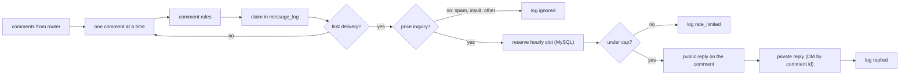
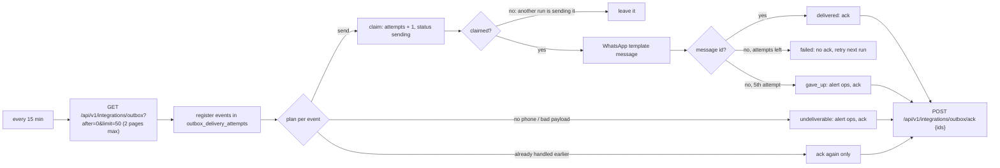

# Workflows in detail

The README shows the [inbound-message-router](../README.md#architecture) diagram. This page
covers the other two message workflows, the canonical message shape, every failure mode, and
the smaller implementation rules.

## inbound-message-router

Meta retries any webhook that does not get a quick 200, for days. The router therefore answers as soon as the signature is verified (a few milliseconds of work) and does the slow part afterwards: the AI call can take tens of seconds when the service has to retry its LLM. The end-to-end test checks this with an AI mock that takes 4 seconds; Meta's request still returns in well under a second. The cost of answering first is that Meta can no longer help with recovery, so failures after the 200 are handled by retries inside n8n and by the error workflow (see [Failure handling](#failure-handling)).

The webhook is answered from the same execution with a Respond to Webhook node, so there is no second workflow or queue to operate.

## instagram-comment-reply

Meta delivers Instagram DMs and comments to the same callback URL, so the router hands comments to this workflow. Rules are ordered: spam (links, gambling spam, follow-for-follow) wins over a price keyword, then insults, then price questions in Indonesian and English. Our own replies come back as comment webhooks and are skipped, which prevents reply loops. The hourly counter is incremented atomically before each reply, so concurrent executions cannot exceed the cap.

## payslip-notifications

Messages to employees are business-initiated, so WhatsApp only accepts them as **pre-approved message templates**; free-form text is rejected outside the 24-hour customer service window. The workflow uses two templates (`payslip_ready` with name, period and link; `salary_paid` with name, period and amount) that must be created and approved in WhatsApp Manager first.

The outbox is at-least-once. Every event id gets a row in `outbox_delivery_attempts` before anything is sent, so an event that was delivered but whose acknowledgement failed is only acknowledged again on the next run, not sent twice. Failed sends stay unacknowledged and come back on the next run. The fifth failed attempt, an employee without a phone number and an invalid payload are terminal: ops gets an alert and the event is acknowledged, so it does not return every 15 minutes forever.

Two runs can overlap when WhatsApp is slow, and n8n has no per-workflow concurrency limit outside queue mode. Before each send the run claims the event with a conditional `UPDATE`, and only the run that changed the row sends. A run takes at most 100 events, so it ends well within the two hours after which a claim left behind by a crashed run expires.

## Canonical message

Every normaliser returns the same shape, which is all the rest of the pipeline knows about a channel:

| Field                 | Example                                     | Notes                                                               |
| --------------------- | ------------------------------------------- | ------------------------------------------------------------------- |
| `channel`             | `whatsapp`, `instagram`, `telegram`         |                                                                     |
| `external_message_id` | `wamid.HBgN...`, IG `mid`, `700000001:42`   | The channel's own id; Telegram ids are only unique per chat         |
| `customer_id`         | `6281200000001`                             | WhatsApp `wa_id`, Instagram-scoped id, Telegram chat id             |
| `customer_name`       | `Rina Wulandari` or `null`                  | Instagram webhooks carry no name                                    |
| `text`                | `kak brp harga paket anggrek?`              | Trimmed, at most 4000 chars; image captions and button titles count |
| `received_at`         | `2026-10-09T10:00:00.000Z`                  | ISO-8601 UTC                                                        |
| `reply_target`        | `{ "phone_number_id": "...", "to": "..." }` | Whatever the channel's send API needs                               |

Dropped before the AI call: WhatsApp delivery and read statuses, reactions and media without text; Instagram echoes of our own messages, reactions, read receipts, edits, deletions and attachment-only messages; Telegram edits, bot senders, group chats (the bot also sits in the admin group) and updates without text.

The request to ai-support-service is the canonical message without `reply_target`. Instagram message ids can be longer than 128 characters; both ai-support-service and `message_log` accept `external_message_id` values up to 255 characters.

## Failure handling

| What happens                                    | Behaviour                                                                                                                                                                                                                                                                         |
| ----------------------------------------------- | --------------------------------------------------------------------------------------------------------------------------------------------------------------------------------------------------------------------------------------------------------------------------------- |
| Bad or missing Meta signature                   | `401`, nothing is processed or stored. The HMAC covers the raw request bytes, not re-serialised JSON. A wrong Telegram `secret_token` also gets `401`; a wrong verify token on the GET handshake gets `403`.                                                                      |
| Duplicate webhook (Meta or Telegram redelivers) | Answered `200`. The insert into `message_log` hits the unique `(channel, external_message_id)` key and the message is skipped before the AI call. ai-support-service is also idempotent on the same key.                                                                          |
| ai-support-service down or slow                 | 100 s timeout, 3 tries 5 s apart with the same `external_message_id` (safe because the service is idempotent). Then the execution fails, the error workflow alerts ops with the execution link, and the `message_log` row stays `processing`. Fix and retry the execution in n8n. |
| ai-support-service answers 4xx                  | Same path: n8n retries every error the same way, so a bad API key surfaces as an ops alert after three tries.                                                                                                                                                                     |
| Channel API 429 or 5xx on a reply               | 3 tries 3 s apart, then the error workflow alerts ops. n8n does not read `Retry-After` and caps the wait between tries at 5 s.                                                                                                                                                    |
| Channel API 429 or 5xx on a payroll template    | 3 tries inside the run, then the event stays unacknowledged and is retried on the next run. The fifth failed run marks it `gave_up`, alerts ops and acknowledges it.                                                                                                              |
| hr-payroll-api down                             | The fetch retries 3 times, then the run fails and ops is alerted. Nothing is acknowledged, so nothing is lost; the next run starts again from `after=0`.                                                                                                                          |
| Acknowledgement call fails                      | Delivered events keep status `delivered` locally and are only re-acknowledged next run, never re-sent.                                                                                                                                                                            |
| Employee without a phone, invalid payload       | Marked `undeliverable`, ops alerted, acknowledged. Unknown event types are marked `skipped` and acknowledged quietly.                                                                                                                                                             |
| MySQL down                                      | The claim step fails, the error workflow alerts ops. Meta has already received its `200`.                                                                                                                                                                                         |
| Comment reply cap reached                       | No reply; the comment is logged as `rate_limited`.                                                                                                                                                                                                                                |

## Implementation notes

- **MySQL node details.** The MySQL node (v2.3+) turns numeric-looking query parameters into numbers, which corrupts 17-digit Instagram ids, so ids are written through the insert and update operations, and the reply counter uses a string key such as `instagram:<id>`. Query placeholders are used once each in ascending order because the node binds values by placeholder number, not by position. These rules are tested in `test/sql.test.js`.
- **Telegram messages in HTML parse mode.** Without a parse mode the n8n Telegram node sends legacy Markdown, where one stray `_` (in a reason code or a customer's text) makes the send fail. HTML only needs `<`, `>` and `&` escaped, which `src/` does for every Telegram text; the validator rejects a Telegram node without `parse_mode: HTML`.

## Adding a channel

A channel is a normaliser and a sender: add `src/normalize-<channel>.js` returning canonical messages, a case in `buildReply` in `src/senders.js` and the channel name in `src/canonical.js`, then a webhook branch with its verification step and a send node behind `Route by Channel`. TikTok was left out on purpose: its direct message API is restricted and not available for general use.
